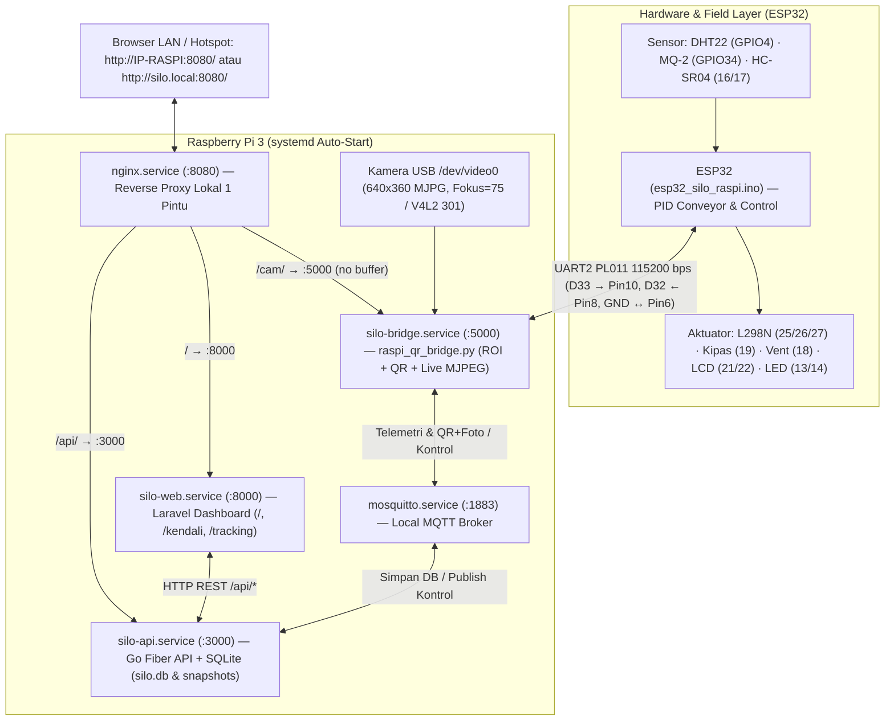

# SILO MONITORING & SMART CONVEYOR — PANDUAN LENGKAP ESP32 ↔ RASPBERRY PI 3 ↔ WEB

Dokumentasi lengkap dari nol hingga **auto-start penuh (jaringan lokal / LAN)** untuk integrasi **ESP32 + Raspberry Pi 3 Model B + Kamera USB QR Vision + MQTT Mosquitto + Go API/SQLite + Dashboard Web Laravel + Nginx**.

> **Status Auto-Start:** Seluruh program di Raspberry Pi 3 sudah dipasang sebagai `systemd` service. **Begitu daya ESP32 dan Raspberry Pi 3 dinyalakan, semua program otomatis menyala sendiri** (~30–45 detik tanpa perlu mengetik perintah apa pun).

---

## 1. Arsitektur & Alur Data Sistem



**Ringkasan alur data 2 arah:**
1. **Monitoring & QR Scan (Hardware → Web):** `ESP32` mengirim `TELEM` & `SCAN_REQ` lewat **UART2 PL011 (`/dev/serial0 -> ttyAMA0`)** ke `raspi_qr_bridge.py` (`:5000`). Kamera memindai QR di ROI conveyor, membalas `SCAN_VALID` / `SCAN_INVALID` / `ITEM_CLEARED` ke ESP32, lalu mem-publish telemetri & QR valid beserta foto JPEG ke `Mosquitto` (`:1883`) → disimpan `Go API` (`:3000`) ke SQLite → ditampilkan `Laravel Dashboard` (`:8000`) lewat 1 pintu `Nginx` (`:8080`).
2. **Kendali Perangkat (Web → Hardware):** Switch di halaman `/kendali` (Mode `AUTO`/`MANUAL`, Kipas, Ventilasi, Konveyor) dikirim `Laravel` → `Go API` → `Mosquitto` → `raspi_qr_bridge.py` → diteruskan lewat **UART2** ke `ESP32`.

---

## 2. Struktur Folder Proyek

```text
SiloMonitoringAndControlling/
├── esp32_silo_raspi/
│   └── esp32_silo_raspi.ino       # Firmware ESP32 (PID pelan halus + anti-stall + UART2 + LED)
├── raspi_qr_bridge.py             # Bridge Raspi (Kamera ROI + QR + UART2 + MQTT + Web :5000)
├── raspi_deploy/                  # Backup config lokal Raspi (systemd, nginx, mosquitto, skrip)
│   ├── nginx_silo.conf
│   ├── mosquitto_silo.conf
│   ├── silo-api.service
│   ├── silo-web.service
│   ├── silo-bridge.service
│   ├── start_web.sh
│   ├── start_silo.sh
│   └── stop_all.sh
├── DATASET/                       # Dataset gambar uji box kopi & QR (19 gambar)
└── README.md
```

> **Repo Web Dashboard (terpisah):** Backend Go + Frontend Laravel tersedia di [`SiloMonitoringAndControlling_WebDashboard`](https://github.com/apipippp/SiloMonitoringAndControlling_WebDashboard).

---

## 3. Wiring Hardware ESP32 ↔ Raspberry Pi 3

### A. Koneksi UART2 & LED Tambahan (WAJIB DISILANG)

| Fungsi | Pin ESP32 | Pin Header 40-Pin Raspi | Catatan |
|---|:---:|---|---|
| **TX2 → RXD** | **D33 (TX2)** | **Pin 10 (GPIO 15 / RXD0)** | Mengirim `TELEM` & `SCAN_REQ` ke Raspi |
| **RX2 ← TXD** | **D32 (RX2)** | **Pin 8 (GPIO 14 / TXD0)** | Menerima `SCAN_VALID`, `SCAN_INVALID`, kontrol web |
| **Common Ground** | **GND** | **Pin 6 (GND)** | **Wajib tersambung** agar sinyal UART terbaca |
| **LED Hijau** | **GPIO 13** | *(ke R 220–330Ω → GND)* | Nyala 2 detik saat QR VALID |
| **LED Merah** | **GPIO 14** | *(ke R 220–330Ω → GND)* | Nyala terus saat INVALID sampai barang diangkat |

**Patokan fisik pin Raspi 3** *(hadapkan port USB & LAN ke KANAN, header 40-pin di ATAS)*:
Baris paling atas (pinggir luar PCB) dari KIRI ke KANAN:
`Pin 2 (5V)` · `Pin 4 (5V)` · **`Pin 6 (GND)`** · **`Pin 8 (TXD → ke D32)`** · **`Pin 10 (RXD → ke D33)`**.

> **Catatan Daya Raspi (Penting):** Jangan berbagi suplai 5V dengan motor/relay lewat Pin 4 karena bisa memicu `throttled=0x50005` (under-voltage, CPU turun dari 1.2 GHz ke 600 MHz). Disarankan pakai **adaptor micro-USB khusus `5V 2.5A–3A`** ke port power Raspi *(cabut kabel 5V di Pin 4, tetapi **biarkan kabel GND di Pin 6 tetap terhubung** ke GND ESP32)*.

### B. Pin Eksisting Rig (Tidak Berubah)
- **Motor L298N:** `ENA=25`, `IN1=26`, `IN2=27`
- **HC-SR04:** `TRIG=16`, `ECHO=17` *(barang diletakkan dekat sensor `1–17.5 cm` lalu bergerak menjauh menuju titik kamera `20.5 cm`)*
- **Relay Kipas (NC/Balik):** `GPIO 19` | **Servo Ventilasi:** `GPIO 18`
- **DHT22:** `GPIO 4` | **MQ-2 Gas:** `GPIO 34` | **LCD I2C:** `SDA=21`, `SCL=22`

---

## 4. Setup ESP32 (`esp32_silo_raspi.ino`)

1. Buka `Silo ESP RASPI/esp32_silo_raspi/esp32_silo_raspi.ino` di Arduino IDE.
2. Pastikan library terpasang: `ESP32Servo`, `DHT sensor library` (+ `Adafruit Unified Sensor`), `LiquidCrystal_I2C`.
3. Pilih board **ESP32 Dev Module** lalu **Upload**.
4. **Parameter PID Perlambatan Halus + Anti-Stall:**
   - `SETPOINT_CM = 20.5` (titik berhenti tepat di tengah ROI kamera)
   - `START_DETECT_CM = 17.5` (zona awal barang masuk) · `DETECT_CM = 22.0` (di bawah pantulan dinding belakang `23 cm`)
   - `PWM_MAX = 125` → melambat proporsional ke `PWM_MIN = 62` (`KP = 6.5`, `KI = 0.45`, `KD = 4.0`, `LEAD_CM = 0.35`, `BRAKE_MS = 180`)
   - **Anti-Stall:** jika belt seret (`< 0.35 cm` selama `400 ms`), PWM otomatis ditambah `+12` bertahap (maks `+45`) lalu melandai lagi begitu bergerak.
5. **Perintah Serial Monitor USB (`115200`, Newline):**
   - `pidlog on` / `pidlog off` — pantau jarak, error, PWM, dan boost anti-stall real-time
   - `sp 20.5` · `pwmmin 62` · `pwmmax 125` · `kp 6.5` · `detcm 22` — tuning live tanpa upload ulang
   - `valid` / `invalid` / `clear` — simulasi balasan Raspi tanpa kabel

---

## 5. Setup Raspberry Pi 3 Dari Nol Sampai Auto-Start

### Langkah 1 — OS, SSH, & Wi-Fi Permanen
- OS: **Raspberry Pi OS Lite 64-bit (aarch64)**, user `kelompok2`, hostname `silo.local`.
- Pastikan Wi-Fi tersimpan permanen di NetworkManager (jangan ada file `.yaml` kosong 0-byte di `/etc/netplan/`):
  ```bash
  sudo nmcli device wifi connect "<NAMA_WIFI>" password "<PASSWORD_WIFI>"
  sudo systemctl disable NetworkManager-wait-online.service
  ```

### Langkah 2 — Aktifkan Hardware PL011 UART (`/dev/serial0 -> ttyAMA0`)
> **Wajib di Raspi 3:** Tanpa `dtoverlay=disable-bt`, `/dev/serial0` memakai mini-UART (`ttyS0`) yang baudrate-nya meleset mengikuti clock GPU sehingga data ESP32 terbaca acak!

1. Tambahkan 2 baris ini di akhir `/boot/firmware/config.txt`:
   ```ini
   enable_uart=1
   dtoverlay=disable-bt
   ```
2. Pastikan di `/boot/firmware/cmdline.txt` **TIDAK** ada `console=serial0,115200` (hanya `console=tty1`).
3. Matikan getty serial & masukkan user ke grup `dialout`:
   ```bash
   sudo systemctl disable --now serial-getty@ttyS0.service 2>/dev/null || true
   sudo usermod -aG dialout kelompok2
   sudo reboot
   ```
4. Verifikasi setelah reboot:
   ```bash
   ls -la /dev/serial0        # wajib menunjuk -> ttyAMA0
   pinctrl get 14,15          # wajib a0 (TXD0 & RXD0)
   ```

### Langkah 3 — Install Paket Dependensi di Raspi
```bash
sudo apt update
sudo apt install -y \
  mosquitto mosquitto-clients \
  python3-opencv python3-numpy python3-serial python3-pyzbar libzbar0 python3-paho-mqtt \
  v4l2-utils sqlite3 nginx-light \
  php-cli php-curl php-mbstring php-xml php-sqlite3
```

### Langkah 4 — Konfigurasi Mosquitto MQTT Lokal
Salin `raspi_deploy/mosquitto_silo.conf` ke `/etc/mosquitto/conf.d/silo.conf`:
```conf
listener 1883 0.0.0.0
allow_anonymous true
```
Lalu aktifkan:
```bash
sudo systemctl enable --now mosquitto
```

### Langkah 5 — Build & Deploy Backend Go + Frontend Laravel + Bridge Python
1. **Cross-compile Go API untuk ARM64 (dari laptop Windows):**
   ```powershell
   cd "Silo ESP RASPI\silo-monitoring\backend"
   $env:GOOS="linux"; $env:GOARCH="arm64"; $env:CGO_ENABLED="0"
   go build -o silo-api-arm64 ./cmd/server
   ```
2. **Install vendor Laravel (dari laptop Windows):**
   ```powershell
   cd "Silo ESP RASPI\silo-monitoring\frontend-silo"
   composer install --no-dev --optimize-autoloader
   ```
3. **Salin ke Raspi `~/Silo_ESP_RASPI/`:**
   - `~/Silo_ESP_RASPI/raspi_qr_bridge.py`
   - `~/Silo_ESP_RASPI/backend/silo-api-arm64` & `.env` (`SIMULATOR=false`, `MQTT_BROKER=tcp://127.0.0.1:1883`, `DB_PATH=data/silo.db`, `CORS_ORIGINS=*`)
   - `~/Silo_ESP_RASPI/frontend/` (termasuk `vendor/` dan `.env` dengan `SILO_PUBLIC_API_URL=auto`)

### Langkah 6 — Konfigurasi Reverse Proxy Nginx (`:8080`)
Salin `raspi_deploy/nginx_silo.conf` ke `/etc/nginx/sites-available/silo`:
- `/` → `127.0.0.1:8000` (Laravel Dashboard, Kendali, Tracking)
- `/api/` → `127.0.0.1:3000/api/` (Go API, SQLite, & JPEG snapshot)
- `/cam/` → `127.0.0.1:5000/` (Live Kamera Vision dengan `proxy_buffering off;` agar MJPEG lancar)

Aktifkan:
```bash
sudo rm -f /etc/nginx/sites-enabled/default
sudo ln -sf /etc/nginx/sites-available/silo /etc/nginx/sites-enabled/silo
sudo nginx -t && sudo systemctl enable --now nginx
```

### Langkah 7 — Pasang Auto-Start Semua Service (`systemd`)
Salin seluruh file `*.service` dari `raspi_deploy/` ke `/etc/systemd/system/`:

| Service | Port | Tugas |
|---|:---:|---|
| `mosquitto.service` | `1883` | Broker MQTT lokal |
| `silo-api.service` | `3000` | Backend Go + SQLite (`data/silo.db` & `data/snapshots/`) |
| `silo-web.service` | `8000` | Frontend Web Laravel (`/`, `/kendali`, `/tracking`) |
| `silo-bridge.service` | `5000` | Kamera USB (`640x360 MJPG`, `--focus 75` = V4L2 `301` + auto-nudge frame 5, `brightness=4`, `contrast=13`, `sharpness=11`) + UART2 + MQTT |
| `nginx.service` | `8080` | Reverse proxy lokal 1 pintu (`/`, `/api/`, `/cam/`) |

Aktifkan semuanya agar **otomatis menyala setiap Raspi dihidupkan**:
```bash
sudo systemctl daemon-reload
sudo systemctl enable --now mosquitto silo-api silo-web silo-bridge nginx
```

---

## 6. Operasional Harian (Saat Nyala & Saat Mematikan)

### A. Alamat Akses Web Lokal (LAN / Hotspot yang Sama)
Semua layanan berjalan lokal di Raspberry Pi (`<IP-RASPI>` bisa dicek lewat `hostname -I`, atau gunakan mDNS `silo.local`):

**Lewat 1 Pintu Nginx (`:8080` — direkomendasikan):**
- **Dashboard Ringkasan:** `http://<IP-RASPI>:8080/` (atau `http://silo.local:8080/`)
- **Kendali Perangkat:** `http://<IP-RASPI>:8080/kendali`
- **Riwayat Tracking + Foto:** `http://<IP-RASPI>:8080/tracking`
- **Live Kamera Vision:** `http://<IP-RASPI>:8080/cam/`
- **API Go:** `http://<IP-RASPI>:8080/api/health`

**Akses Langsung per Port (tanpa Nginx):**
- **Laravel Dashboard:** `http://<IP-RASPI>:8000/`
- **Go API + SQLite:** `http://<IP-RASPI>:3000/api/health`
- **Live Kamera Vision:** `http://<IP-RASPI>:5000/`
- **MQTT Broker:** `tcp://<IP-RASPI>:1883`

### B. Perintah Cek Status, Log, & Shutdown Aman
```bash
# Cek seluruh 5 service lokal sekaligus
systemctl is-active mosquitto silo-api silo-web silo-bridge nginx

# Lihat log bridge kamera/UART secara live
journalctl -u silo-bridge -f

# Cek suhu & kesehatan daya Raspi (sehat = throttled=0x0)
vcgencmd measure_temp && vcgencmd get_throttled && free -h

# Cek isi database SQLite
sqlite3 ~/Silo_ESP_RASPI/backend/data/silo.db "SELECT id, datetime(ts,'unixepoch','localtime'), batch_id, material, snapshot FROM scans ORDER BY id DESC LIMIT 10;"

# WAJIB sebelum mencabut listrik Raspi (tunggu ~10 detik sampai LED hijau berhenti berkedip)
sudo shutdown -h now
```

---

## 7. Troubleshooting Cepat

| Gejala | Penyebab Umum | Solusi |
|---|---|---|
| Status ESP di `:5000` `OFFLINE` (0 byte) | Kabel `D32`/`D33` belum disilang atau GND Pin 6 lepas | Pastikan **D33 → Pin 10**, **D32 ← Pin 8**, **GND ↔ Pin 6** |
| Data masuk dari ESP32 tapi teks acak | Raspi 3 masih pakai mini-UART `ttyS0` | Pastikan `dtoverlay=disable-bt` ada di `/boot/firmware/config.txt` lalu reboot (`ls -la /dev/serial0` harus `ttyAMA0`) |
| ESP32 kirim data lancar, tapi perintah dari web/Raspi tidak direspons | Kabel balik **Pin 8 → D32** kendor/putus | Ganti jumper Pin 8 ↔ D32 |
| Kamera buram saat baru nyala | Motor lensa UVC belum bergerak sebelum stream aktif | Sudah ditangani otomatis oleh **auto-nudge frame ke-5** di `raspi_qr_bridge.py` (`--focus 75` = V4L2 `301`) |
| `vcgencmd get_throttled` keluar `0x50005` | Daya 5V drop (berbagi pin dengan motor/relay) | Pakai adaptor micro-USB khusus `5V 2.5A–3A` ke Raspi, cabut kabel 5V Pin 4 (pertahankan GND Pin 6) |
| Web kamera menampilkan `BARANG` padahal sabuk kosong | Pencahayaan / posisi senter berubah | Kosongkan belt, lalu klik **`Kalibrasi Belt Kosong`** sekali di halaman `/cam/` |
